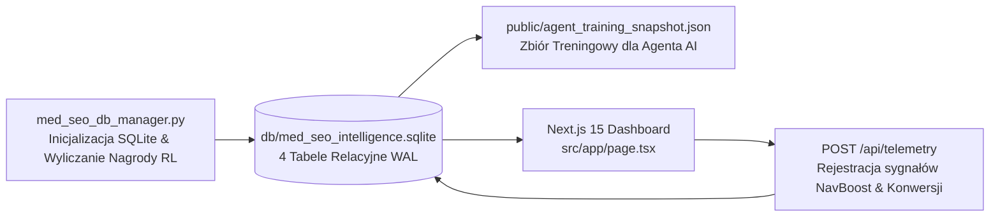

# Silnik Danych MedSEO Next.js 15 i Trener Agenta AI (SQLite + NavBoost + E-E-A-T + GEO)

[](https://nextjs.org/)
[](https://www.sqlite.org/)
[](https://www.python.org/)
[](#2-model-matematyczny-oceny-seo-i-konwersji-medycznej)

Silnik bazodanowy i analityczny **Next.js 15 + SQLite (WAL) + Python RL Trainer** zaprojektowany do ilościowej oceny widoczności podstron medycznych w **Google Search (YMYL)**, **Google AI Overviews (GEO)** oraz trenowania **Agenta AI (Contextual Bandit / Reinforcement Learning)** pod kątem maksymalizacji konwersji pacjentów (rezerwacje wizyt, wyceny zabiegów, interakcje z modelami 3D).

---

## 1. Architektura Przepływu Danych i Treningu Agenta AI



---

## 2. Model Matematyczny Oceny SEO i Konwersji Medycznej

Silnik `src/lib/seo-scoring-engine.ts` oraz `med_seo_db_manager.py` oblicza dla każdego wariantu treści medycznej trzy kluczowe wskaźniki:

### A. Złożony Wynik Google Search (`Composite SEO Score 0–100`)

$$\text{Composite SEO} = 0.35 \cdot \text{NavBoost} + 0.25 \cdot \text{E-E-A-T} + 0.20 \cdot \text{GEO} + 0.10 \cdot \text{CWV} + 0.10 \cdot \text{Domain}$$

1. **NavBoost / Sygnały Behawioralne (`35%` wagi)**:
   - Stosunek `good_clicks` (sesje `>45 s` lub interakcja z widgetem) do `bad_clicks` (*pogo-sticking* `<12 s`),
   - Udział `last_longest_clicks` (spełniona intencja wyszukiwania) oraz znormalizowany `avg_dwell_time_sec`.
2. **E-E-A-T / YMYL (`25%` wagi)**:
   - Weryfikacja lekarza i numeru **PWZ** (`author_pwz_verified`),
   - Liczba cytowań klinicznych (`clinical_citations_count`), autorskich materiałów 3D/wideo (`original_media_count`) oraz `effort_score`.
3. **AI Overviews / GEO (`20%` wagi)**:
   - Optymalna długość bloku odpowiedzi bezpośredniej pod nagłówkiem `H2` (**`130–170 słów`**),
   - Kompletność grafu `Schema.org JSON-LD` (`MedicalClinic`, `Physician`, `MedicalProcedure`, `FAQPage`) oraz nasycenie encjami medycznymi (`entity_density_score`).
4. **Core Web Vitals (`10%` wagi)**:
   - `LCP <= 2500 ms`, `INP <= 200 ms`, `CLS <= 0.10`.
5. **Architektura Domeny / QualityBoost (`10%` wagi)**:
   - Głębokość kliknięć od strony głównej (`click_depth_from_home <= 2`), `site_focus_alignment` oraz niskie odchylenie `site_radius_deviation`.

### B. Skuteczność Sprzedaży Usług Medycznych (`Sales Effectiveness Score 0–100`)
Uwzględnia współczynnik konwersji (`bookings_completed + phone_click_calls + calculator_leads`) oraz zaangażowanie w interaktywne moduły 3D/kalkulatory (`interactive_widget_uses`).

### C. Sygnał Nagrody RL dla Agenta AI (`Agent Reward Signal 0.000–1.000`)

$$\text{Reward} = \frac{0.60 \cdot \text{SalesScore} + 0.40 \cdot \text{CompositeSEO}}{100}$$

---

## 3. Schemat Bazy Danych SQLite (`db/schema.sql`)

| Tabela | Przeznaczenie | Kluczowe Kolumny |
| :--- | :--- | :--- |
| `medical_content_variants` | Eksperymentalne warianty podstron zabiegowych | `slug`, `service_category`, `content_format`, `author_pwz_verified`, `aio_passage_word_count`, `schema_jsonld_types`, `effort_score` |
| `navboost_conversion_metrics` | Sygnały SERP / On-Page oraz konwersje sprzedażowe | `good_clicks`, `bad_clicks`, `last_longest_clicks`, `avg_dwell_time_sec`, `bookings_completed`, `estimated_revenue_pln` |
| `cwv_technical_metrics` | Pomiary wydajności technicznej Core Web Vitals | `lcp_ms`, `inp_ms`, `cls_score`, `ttfb_ms`, `cwv_passed` |
| `agent_learning_dataset` | Zbiór treningowy RL z rekomendacjami dla Agenta AI | `composite_seo_score`, `sales_effectiveness_score`, `agent_reward_signal`, `winning_pattern_summary`, `recommended_action` |

---

## 4. Struktura Projektu

```text
MED_SEO_NEXTJS_DATA_ENGINE/
├── db/
│   ├── schema.sql                      # Definicja 4 tabel SQLite (tryb WAL)
│   └── med_seo_intelligence.sqlite     # Wygenerowana baza danych SQLite
├── public/
│   └── agent_training_snapshot.json    # Eksport JSON z rankingiem archetypów treści dla Agenta AI
├── src/
│   ├── app/
│   │   ├── api/telemetry/route.ts      # Punkt końcowy REST API do zapisu telemetrii NavBoost i konwersji
│   │   └── page.tsx                    # Panel analityczny Next.js 15 i symulator blueprintów treści
│   └── lib/
│       └── seo-scoring-engine.ts       # Silnik obliczeniowy TypeScript dla Next.js
├── med_seo_db_manager.py               # Skrypt inicjalizujący bazę SQLite i obliczający metryki RL
└── package.json
```

---

## 5. Szybki Start

```bash
# 1. Zainstaluj zależności Node.js
npm install

# 2. Zainicjalizuj bazę SQLite i wygeneruj snapshot treningowy dla Agenta AI
npm run db:seed

# 3. Uruchom serwer deweloperski Next.js 15
npm run dev
```
